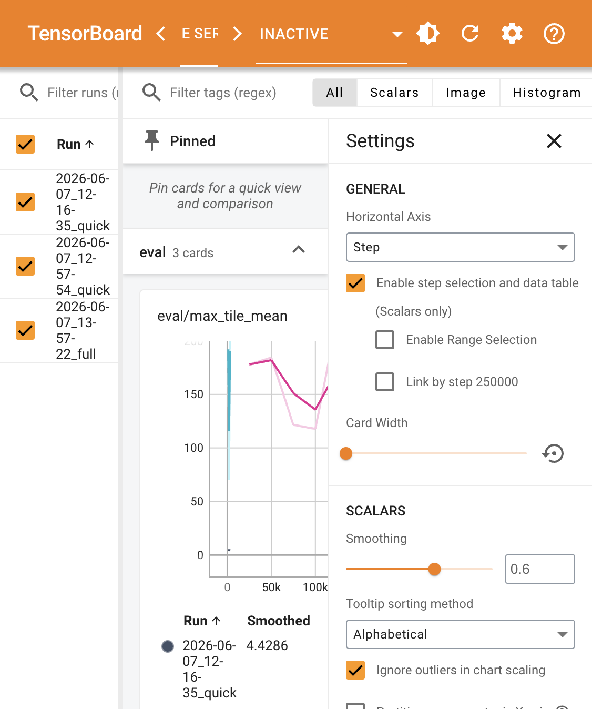

# Board 使用说明书

> **2048 RL 训练实验平台 — TensorBoard 指标与操作指南**  
> 版本：v1.0 ｜ 日期：2026-06-07 ｜ 适用项目：`rl-2048-platform`

---

## 1. TensorBoard 是什么？

在本项目中，**TensorBoard** 承担「训练可视化」职责（与 2048 **GUI 对局界面**分工不同）：

| 工具 | 用途 |
|------|------|
| **TensorBoard** | 查看训练/评估**数值曲线**，对比不同实验 |
| **2048 GUI**（`make play`） | 图形化**下棋对局**、AI 演示 |

每次训练会在 `runs/<时间戳>_<配置名>/` 下自动生成 TensorBoard 日志文件（`events.out.tfevents.*`）。

---

## 2. 快速启动

### 2.1 一键启动（推荐）

```bash
# 在项目根目录执行
make board

# 默认地址
# http://localhost:6006
```

### 2.2 自定义端口 / 日志目录

```bash
make board PORT=6007              # 6006 被占用时换端口
make board LOGDIR=runs            # 指定日志根目录（默认 runs）
```

### 2.3 手动启动

```bash
.venv/bin/python -m tensorboard.main --logdir runs --port 6006 --host 127.0.0.1
```

### 2.4 浏览器访问

打开：**http://127.0.0.1:6006**

> 训练进行中可保持 TensorBoard 开启，点击右上角刷新按钮或等待自动更新即可看到新数据。

---

## 3. 界面总览（图文）



### 3.1 界面分区说明

```
┌─────────────────────────────────────────────────────────────────┐
│  顶栏：TensorBoard Logo | 主题切换 | 刷新 | 设置 | 帮助          │
├──────────┬──────────────────────────────────────┬───────────────┤
│ 左侧     │  主区域（曲线卡片）                    │ 右侧设置面板   │
│ Run 列表 │  - 按标签分组：train / eval            │ - 横轴：Step  │
│ ☑ 勾选   │  - 每张卡片一条指标曲线                 │ - Smoothing   │
│ 实验对比 │  - 悬停显示数值表                       │ - 异常值过滤  │
└──────────┴──────────────────────────────────────┴───────────────┘
```

### 3.2 左侧 Run 列表

每个训练实验对应一个 Run，命名规则：

```
runs/2026-06-07_13-57-22_full/
      └─ 日期_时间_配置名
```

**操作：**
- **勾选/取消** Run 前的复选框 → 控制曲线是否显示
- **Filter runs (regex)** → 用正则过滤 Run 名称
- 建议：对比实验时同时勾选 `quick` 与 `full` 等多条 Run

### 3.3 主区域标签页

| 标签 | 说明 |
|------|------|
| **Scalars** | 标量曲线（本项目主要使用） |
| Image / Histogram | 本项目未记录，通常为空 |

### 3.4 右侧 Settings（设置面板）

| 设置项 | 推荐值 | 说明 |
|--------|--------|------|
| Horizontal Axis | **Step** | 横轴为训练步数（也可用 Wall time） |
| Smoothing | **0.6** | 曲线平滑，便于看趋势；0=原始数据 |
| Ignore outliers | **开启** | 忽略极端值，避免 Y 轴被拉扁 |
| Enable step selection | **开启** | 点击曲线显示精确数值表 |

---

## 4. 指标说明书（共 9 项）

本项目在 TensorBoard 中记录 **9 个标量指标**，分为 **train（训练过程）** 与 **eval（周期性评估）** 两组。

### 4.1 指标总览表

| 指标 Tag | 分组 | 记录时机 | 横轴 Step 含义 |
|----------|------|----------|----------------|
| `train/episode_reward` | train | 每局结束 | 该局结束时的训练步数 |
| `train/episode_len` | train | 每局结束 | 同上 |
| `train/max_tile` | train | 每局结束 | 同上 |
| `train/score` | train | 每局结束 | 同上 |
| `train/epsilon` | train | 每局结束 | 同上 |
| `train/loss` | train | 每局结束 | 同上 |
| `eval/max_tile_median` | eval | 每 `eval_every` 步 | 触发评估时的步数 |
| `eval/max_tile_mean` | eval | 每 `eval_every` 步 | 同上 |
| `eval/score_mean` | eval | 每 `eval_every` 步 | 同上 |

---

### 4.2 train 组（训练过程指标）

记录于**每一局 2048 对局结束**时，反映 Agent 在训练中的实时表现。

#### `train/episode_reward`

| 属性 | 说明 |
|------|------|
| **含义** | 单局累计 reward（合并得分 + reward 塑形项） |
| **单位** | 无（项目自定义奖励尺度） |
| **期望趋势** | 整体上升 → Agent 学会拿更高分 |
| **异常信号** | 长期贴近 0 或剧烈震荡不收敛 |

#### `train/episode_len`

| 属性 | 说明 |
|------|------|
| **含义** | 单局步数（从 reset 到终局/truncated） |
| **单位** | 步 |
| **期望趋势** | 变长通常表示 Agent 存活更久 |
| **参考** | `max_steps` 上限（quick=2000，full=5000） |

#### `train/max_tile`

| 属性 | 说明 |
|------|------|
| **含义** | 单局出现的**最大方块值**（如 64、128、512） |
| **单位** | 方块数值（2 的幂） |
| **期望趋势** | **核心智能性指标**：从 32→64→128→256→512 攀升 |
| **解读** | 比 reward 更直观——「Agent 是否在变聪明」 |

#### `train/score`

| 属性 | 说明 |
|------|------|
| **含义** | 单局最终棋盘总分（经典 2048 计分规则） |
| **单位** | 分 |
| **期望趋势** | 随 max_tile 提升而增加 |

#### `train/epsilon`

| 属性 | 说明 |
|------|------|
| **含义** | DQN 探索率 ε（ε-greedy） |
| **范围** | `eps_start`（1.0）→ `eps_end`（0.02~0.1）线性衰减 |
| **期望趋势** | 单调下降 |
| **解读** | 高 ε = 多探索；低 ε = 多利用已学策略 |

#### `train/loss`

| 属性 | 说明 |
|------|------|
| **含义** | DQN 最近一次梯度更新的 TD Loss（MSE） |
| **单位** | 无 |
| **期望趋势** | 先升后降或逐步稳定（非必须单调） |
| **异常信号** | 长期为 0 → 可能尚未开始学习（`learning_starts` 前） |

---

### 4.3 eval 组（周期性评估指标）

记录于训练每 **`eval_every` 步**（quick=1000，full=25000）触发一次**贪心评估**（无探索，动作屏蔽合法方向）。

评估方式：跑 `eval_episodes` 局（quick=10，full=25），统计结果写入 TensorBoard。

#### `eval/max_tile_median` ⭐ 最重要

| 属性 | 说明 |
|------|------|
| **含义** | 评估局中 **max_tile 的中位数** |
| **用途** | **S2 达标判定依据**（目标 ≥ **512**） |
| **期望趋势** | 稳步上升，最终 ≥ 512 |
| **与 best.pt** | 本指标创新高时自动保存 `best.pt` |

#### `eval/max_tile_mean`

| 属性 | 说明 |
|------|------|
| **含义** | 评估局中 max_tile 的**平均值** |
| **对比 median** | mean 受极端高/低局影响更大 |

#### `eval/score_mean`

| 属性 | 说明 |
|------|------|
| **含义** | 评估局中最终总分的平均值 |
| **用途** | 辅助观察得分水平，非 S2 主指标 |

---

## 5. 典型使用场景

### 场景 A：确认训练是否在学

1. `make board` 打开 TensorBoard  
2. 勾选当前 Run  
3. 查看 **`train/max_tile`** 和 **`eval/max_tile_median`**  
4. 若曲线整体抬升 → 训练有效

### 场景 B：对比 quick vs full 配置

1. 左侧同时勾选：
   - `2026-06-07_12-57-54_quick`
   - `2026-06-07_13-57-22_full`
2. 打开 **`eval/max_tile_median`** 卡片  
3. 对比哪条曲线更高、更稳

### 场景 C：判断何时停止训练

1. 观察 **`eval/max_tile_median`** 是否进入平台期（不再上升）  
2. 若已达 **512** → 可停止，用 `best.pt` 做评估/GUI 演示  
3. 对应检查点路径见 `runs/<id>/train.log` 中 `[best]` 行

### 场景 D：排查训练异常

| 现象 | 可能原因 | 建议 |
|------|----------|------|
| loss 长期为 0 | 未到 `learning_starts` | 正常，继续等待 |
| max_tile 不升 | reward 稀疏 / 步数不够 | 加长训练或调 reward 塑形 |
| eval 剧烈抖动 | 评估局数太少 | 增大 `eval_episodes` |
| 曲线空白 | Run 未勾选 / 训练未产出日志 | 检查 `runs/` 目录 |

---

## 6. 日志文件与目录结构

```
runs/
└── 2026-06-07_13-57-22_full/          # 一次实验
    ├── config.snapshot.yaml           # 配置快照（可复现）
    ├── events.out.tfevents.*          # ← TensorBoard 读取此文件
    ├── train.log                      # 文本日志（ckpt/best 记录）
    ├── ckpt_25000.pt                  # 周期检查点
    ├── ckpt_50000.pt
    └── best.pt                        # eval median 最优模型
```

**文本日志与 TensorBoard 的关系：**

| 文件 | 内容 |
|------|------|
| `events.out.tfevents.*` | 曲线数据（TensorBoard 可视化） |
| `train.log` | `[ckpt]` / `[best]` / `[done]` 文字记录 |
| `config.snapshot.yaml` | 当次实验完整超参数 |

---

## 7. 配置项与指标的关系

| 配置项（YAML） | 影响的 TensorBoard 行为 |
|----------------|-------------------------|
| `eval_every` | eval 曲线数据点的间隔（步） |
| `eval_episodes` | 每次评估的方差大小（越大越稳） |
| `eps_decay_steps` | `train/epsilon` 下降速度 |
| `learning_starts` | loss 开始非零前的步数 |
| `save_every` | 不产生 TensorBoard 指标，但产生 ckpt 文件 |

当前配置参考：
- **quick**：`configs/quick.yaml`（3k 步，验证管线）
- **full**：`configs/full.yaml`（250k 步，追求效果）

---

## 8. 常见问题（FAQ）

**Q1：打开 http://localhost:6006 显示空白？**  
- 确认 `runs/` 下存在 `events.out.tfevents.*` 文件  
- 左侧勾选至少一个 Run  
- 训练尚未结束时，eval 曲线可能较少，train 曲线会持续增加

**Q2：端口被占用？**  
```bash
make board PORT=6007
```

**Q3：TensorBoard 与 make eval 的区别？**  
- TensorBoard：看**训练过程**趋势  
- `make eval`：对某个 `best.pt` 做**一次性正式验收**（100 局，输出 S2 判定）

**Q4：如何关联到 GUI 演示？**  
```bash
make play CKPT=runs/<你的run>/best.pt
```

---

## 9. 当前项目实验 Run 一览

| Run 目录 | 配置 | 说明 |
|----------|------|------|
| `2026-06-07_12-16-35_quick` | quick | 动作屏蔽修复前 |
| `2026-06-07_12-57-54_quick` | quick | 动作屏蔽修复后 |
| `2026-06-07_13-57-22_full` | full | 250k 步 full 训练，best median=256 |

---

## 10. 附录：指标记录源码位置

指标在 `src/train/train.py` 中写入：

```python
# 每局结束 → train/* 六项
logger.log_scalars({
    "train/episode_reward": ...,
    "train/episode_len": ...,
    "train/max_tile": ...,
    "train/score": ...,
    "train/epsilon": ...,
    "train/loss": ...,
}, step=step)

# 每 eval_every 步 → eval/* 三项
logger.log_scalars({
    "eval/max_tile_median": ...,
    "eval/max_tile_mean": ...,
    "eval/score_mean": ...,
}, step=step)
```

---

*文档结束。如有问题，请参阅 `README.md` 或 `artifacts/prototype/prototype.md` 中的 P-03 TensorBoard 面板说明。*
