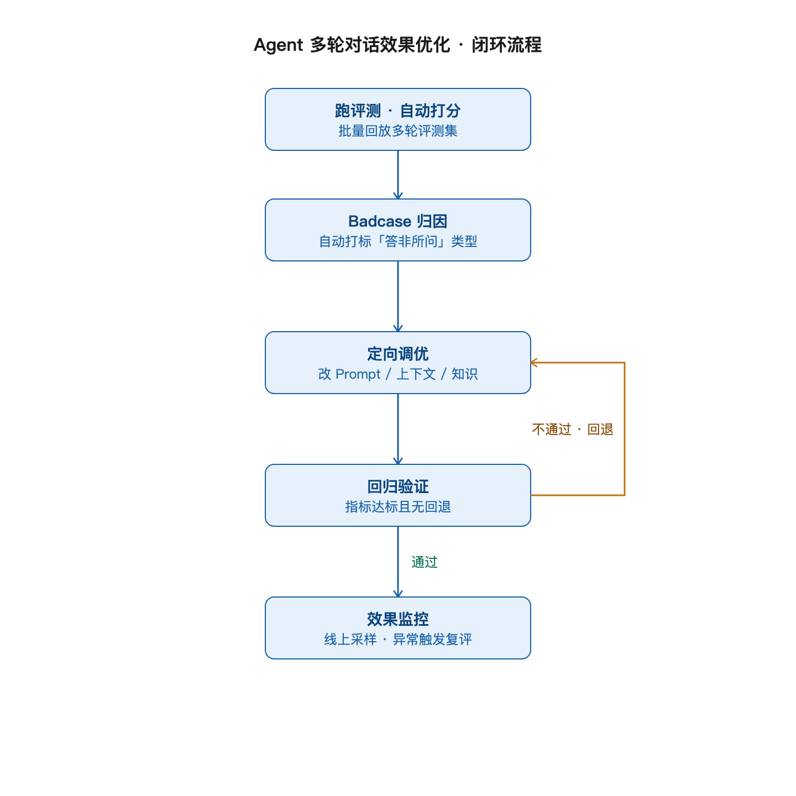
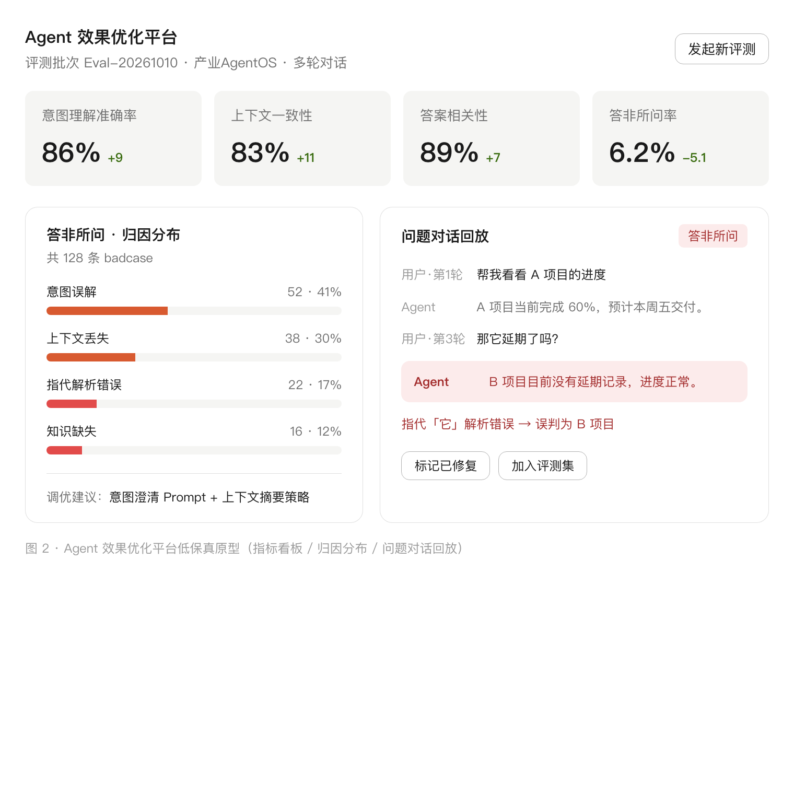

# 20261010_Agent 多轮对话效果优化

## 1. 需求概述

### 1.1 背景

产业 AgentOS 平台上的 Agent 已具备多轮对话能力，但在实际使用中频繁出现**答非所问**：用户在第 3 轮及以后提问时，Agent 对"它""这个""上面那个"等指代理解错误、丢掉前文上下文、或答非当前话题。当前缺少系统化的效果度量与优化闭环，问题只能靠零星的用户反馈被发现，修复后也无法量化是否真的变好。

### 1.2 目标

建立一套针对 **Agent 多轮对话体验** 的「评测 → 归因 → 调优 → 回归」闭环，**重点解决答非所问问题**，使多轮对话质量可量化、可迭代、可持续提升。

### 1.3 用户故事

> **作为** Agent 产品负责人，  
> **我希望** 建立一套针对 Agent **多轮对话体验**的「评测 → 归因 → 调优 → 回归」闭环，重点解决**答非所问**问题，  
> **以便** 让 Agent 在多轮对话中准确理解用户真实意图、稳定给出对口答案，使对话质量可量化、可迭代、可持续提升。

### 1.4 验收标准

| # | Given | When | Then |
|-|-|-|-|
| AC1 | 一个线上多轮对话 Agent | 跑一轮标准多轮评测集 | 输出意图理解准确率 / 上下文一致性 / 答案相关性 / 多轮完成率等指标并落库可比对 |
| AC2 | 评测发现某类高频 badcase（如"第3轮后答非所问"） | 完成定向调优（Prompt / 上下文管理 / 知识补充） | 回归验证显示该类指标提升，且其余指标无回退 |
| AC3 | 任何一次对话 | 出现答非所问或前后矛盾 | 系统自动打标为 badcase 并归入对应问题类型，可追溯 |

## 2. 核心流程

### 2.1 端到端主流程（正常流）

| 步骤 | 触发条件 | 操作 | 结果 |
|-|-|-|-|
| S1 建评测集 | 上线新 Agent 或需迭代 | 沉淀多轮对话用例（覆盖意图理解、上下文指代、多轮追问等场景），标注标准答案 | 形成版本化评测集 |
| S2 跑评测 | 评测集就绪 / 每次调优后 | 自动批量回放用例，调用 Agent 逐轮对话，采集每一轮输入输出 | 生成原始对话记录 |
| S3 自动打分 | 原始记录产出 | 按指标自动评分：意图理解准确率、上下文一致性、答案相关性、多轮完成率 | 输出评分结果 + 总览看板 |
| S4 Badcase 归因 | 出现低分 / 答非所问 | 自动打标问题类型（意图误解 / 上下文丢失 / 指代错误 / 知识缺失 / 答非所问），聚合到问题分类 | 形成 badcase 清单 |
| S5 定向调优 | badcase 清单确认 | 针对问题类型根因做定向优化：改 Prompt、调上下文管理策略、补知识库 | 产出调优版本 |
| S6 回归验证 | 调优版本产出 | 用同一评测集 + 新增该 badcase 用例重跑，对比调优前后指标 | 达标且无回退 → 通过；否则回到 S5 |
| S7 效果监控 | 通过回归 | 上线后持续采样线上真实对话，监控核心指标波动 | 指标异常触发新一轮归因 |

### 2.2 闭环流程图

闭环整体流程见文末 **图 1**：从「跑评测 · 自动打分」出发，依次进入「Badcase 归因 → 定向调优 → 回归验证」，回归通过后进入「效果监控」；若回归不通过则回退至「定向调优」重新迭代。

### 2.3 异常流 / 边界情况

- **E1 评测集本身不准**：标准答案有争议 → 需引入复核机制，标注口径统一后再入集。
- **E2 调优后其他指标回退**：某类指标升但另一类降 → 判定为"拆东墙补西墙"，回退调优，要求净提升。
- **E3 线上 badcase 不在评测集覆盖范围**：出现新类型答非所问 → 补充为评测集新用例，进入下一轮闭环。
- **E4 指标口径不一致**：同一 badcase 多轮打分波动 → 需固定打分模型 / 规则版本，保证可比性。

### 2.4 角色与关键输入输出

- **角色**：Agent 产品负责人（主）、算法/工程（调优执行）、标注人员（评测集建设，仅建设期参与）
- **关键输入**：评测集、Agent 版本、Prompt / 知识库配置
- **关键输出**：评测报告、badcase 清单、调优版本、回归结论、效果看板
- **状态流转**：待评测 → 评测中 → 已归因 → 调优中 → 待回归 → 已通过 / 未通过

## 3. 原型图

低保真原型见文末 **图 2**，包含三个核心界面：

1. **评测指标看板**：顶部 4 个核心指标卡片 —— 意图理解准确率、上下文一致性、答案相关性、答非所问率，均带调优前后变化值。
2. **答非所问 · 归因分布**：按问题类型（意图误解 / 上下文丢失 / 指代解析错误 / 知识缺失）展示 badcase 数量与占比，并给出调优建议。
3. **问题对话回放**：完整回放一段多轮对话，高亮答非所问的 Agent 回复并标注根因（如"指代『它』解析错误 → 误判为 B 项目"），支持"标记已修复""加入评测集"操作。

## 4. 功能清单

| # | 功能点 | 描述 | 优先级 |
|-|-|-|-|
| F1 | 多轮评测集管理 | 用例的创建、编辑、版本管理，覆盖意图理解/上下文指代/多轮追问场景 | P0 |
| F2 | 批量评测执行 | 自动批量回放用例，逐轮调用 Agent 并采集输入输出 | P0 |
| F3 | 自动打分 | 按意图理解准确率、上下文一致性、答案相关性、多轮完成率自动评分 | P0 |
| F4 | 指标看板 | 核心指标总览与调优前后对比 | P0 |
| F5 | Badcase 自动打标与归因 | 自动识别答非所问并按问题类型归类聚合 | P0 |
| F6 | 问题对话回放 | 回放完整多轮对话，高亮问题轮次并展示根因 | P0 |
| F7 | 定向调优任务 | 从 badcase 一键发起调优任务，记录 Prompt/上下文/知识变更 | P1 |
| F8 | 回归验证对比 | 调优前后指标对比、回退预警 | P0 |
| F9 | 线上效果监控 | 采样线上真实对话，监控指标波动并异常预警 | P1 |
| F10 | Badcase 一键入集 | 将线上 badcase 加入评测集，持续扩充覆盖 | P1 |

## 5. 非功能与边界

- **权限**：评测集与调优配置需角色权限控制，仅产品/算法可编辑，其他角色只读。
- **性能**：单轮批量评测需支持并发回放，评测集规模 ≥ 500 条时单批次完成时间可接受。
- **可比性**：打分模型 / 规则需版本化，保证跨批次指标可比；口径变更须标注版本。
- **异常**：评测执行中断可断点续跑；Agent 调用失败重试并有失败统计。
- **兼容性**：需兼容平台内多类多轮对话 Agent，评测流程与具体 Agent 解耦。

## 6. 待确认事项

- 评测指标的具体口径与阈值（答辩/上线标准）
- 自动打分采用「模型评测」还是「规则 + 人工抽检」组合
- 首批纳入评测的 Agent 范围
- 线上监控采样频率与告警阈值

## 附录 · 图表

图 1 · Agent 多轮对话效果优化闭环流程图

图 2 · Agent 效果优化平台低保真原型（指标看板 / 归因分布 / 问题对话回放）

