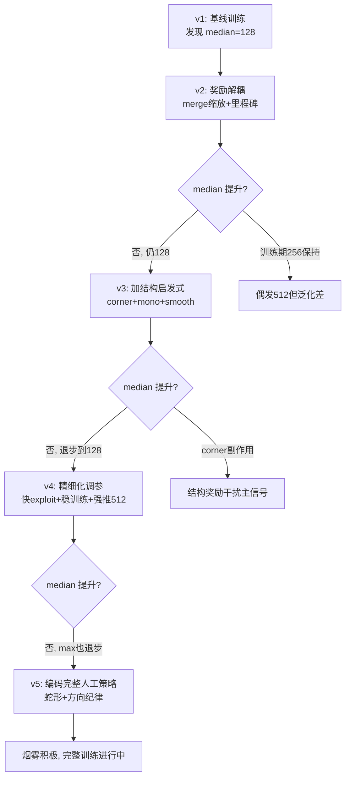

# 策略修改与配置调整报告

> **2048 RL 训练实验平台 — 调参迭代复盘**  
> 版本：v1.0 ｜ 日期：2026-06-07 ｜ 目标：S2 达标（评估 max_tile 中位数 ≥ 512）

---

## 1. 背景与目标

| 项目 | 说明 |
|------|------|
| **S2 达标线** | 贪心评估 100 局，`max_tile` **中位数 ≥ 512** |
| **随机基线** | median ≈ 128，max ≈ 256 |
| **算法** | Vanilla DQN + MLP（16 维展平观测） |
| **硬件** | Apple M2，PyTorch MPS |

初始 `full` 训练（v1）完成后，评估 median 仅 128（与随机持平），偶发 max 达 512。此后进行了 **5 轮策略/配置迭代**（v1→v5），并伴随多项代码级改进。

---

## 2. 迭代总览

```
v1 full ──► v2 奖励重塑 ──► v3 结构奖励 ──► v4 快 exploitation ──► v5 蛇形策略
 250k         600k              600k              800k                800k(进行中)
 best=256     best=256          best=128↓         best=128            best=128(暂)
 eval=128     eval=128          eval=128          eval=128            eval=128(暂)
```

**结论先行**：五轮迭代中，**训练期 best_eval_median 的最高纪录仍为 256**（v1/v2），**正式评估 median 始终为 128**，**S2 从未达标**。v3 之后训练期指标出现退步；v5 蛇形策略训练尚在进行中， interim 结果未见突破。

---

## 3. 各版本改动逻辑与结果

### 3.0 前置修复（动作屏蔽，非版本号但影响全局）

| 改动 | 逻辑 | 效果 |
|------|------|------|
| **RV-1 动作屏蔽** | 训练/评估时仅在合法方向中选动作，避免无效滑动浪费步数 | quick 3k 步 eval median 从 **4 → 256**，证明管线有效 |
| **TD 目标合法 masking** | `learn()` 中 next Q 也只在合法动作上取 max | 减少 Q 值过估计噪声 |
| **replay 存 next_legal_mask** | 回放采样时携带合法掩码 | 支撑 TD masking |

---

### 3.1 v1 — `configs/full.yaml`（基线）

**Run**：`runs/2026-06-07_13-57-22_full`

#### 改动逻辑

- 首次 full 训练，验证完整管线
- 轻量奖励塑形：`reward_empty_coef=0.02`，`reward_new_max_bonus=1.5`
- 标准超参：250k 步，`[256,256,128]` 网络，`gamma=0.99`

#### 核心问题诊断

合并得分（merge score）单步可达数百，远超塑形奖励（~0.3/步），Agent 优化短期合并而非长期布局。

#### 训练结果

| 指标 | 数值 |
|------|------|
| 步数 / 耗时 | 250k / 502s |
| 训练 best_eval_median | **256**（step 125k） |
| 正式评估 median | **128** |
| 正式评估 max | **512** |
| S2 | ❌ FAIL |

---

### 3.2 v2 — 奖励重塑 + 算法加固

**配置**：`configs/full_v2.yaml`（600k）  
**Run**：`runs/2026-06-07_14-48-35_full_v2`

#### 改动逻辑

| 类别 | 改动 | 目的 |
|------|------|------|
| **奖励解耦** | `merge_reward_scale: 0.05`，降低合并得分主导 | 让塑形项有话语权 |
| **里程碑奖励** | 128→+2, 256→+8, 512→+25, 1024→+80 | 明确激励冲击高方块 |
| **更大网络** | `[512, 512, 256]` | 提升表达能力 |
| **更长训练** | 600k 步 | 给收敛更多时间 |
| **代码** | TD 合法 masking、replay 存掩码 | 训练正确性 |

#### 训练结果

| 指标 | v1 | v2 | 变化 |
|------|----|----|------|
| 步数 | 250k | 600k | +140% |
| 训练 best_eval_median | 256 | **256** | 持平 |
| 正式评估 median | 128 | **128** | 持平 |
| 正式评估 max | 512 | **512** | 持平 |
| score_mean | 2200 | 2206 | 微升 |
| S2 | FAIL | FAIL | 无改善 |

**复盘**：奖励重塑方向正确，但 600k 步未能将训练期 256 转化为评估期稳定 median。偶发 512 依旧，策略泛化不足。

---

### 3.3 v3 — 结构奖励（角落 + 单调 + 平滑）

**配置**：`configs/full_v3.yaml`（600k）  
**Run**：`runs/2026-06-07_15-27-39_full_v3`

#### 改动逻辑

将经典 2048 启发式编码为每步结构分增量奖励：

| 组件 | 权重 | 含义 |
|------|------|------|
| `corner` | 2.0 + log 放大 | 最大方块锚定四角 |
| `monotonicity` | 0.3 | 行列单调蛇形 |
| `smoothness` | 0.04 | 相邻方块平滑 |
| `structure_coef` | 1.0 | 结构分变化量塑形 |

#### 训练结果

| 指标 | v2 | v3 | 变化 |
|------|----|----|------|
| 训练 best_eval_median | 256 | **128** | ⬇️ **退步** |
| 正式评估 median | 128 | 128 | 持平 |
| 正式评估 max | 512 | 512 | 持平 |
| S2 | FAIL | FAIL | 无改善 |

**复盘**：corner log 放大 + 高权重导致奖励信号不稳定；结构分与里程碑/合并奖励相互干扰，训练期指标反而下降。

---

### 3.4 v4 — 快 exploitation + 稳定训练 + 强推 512

**配置**：`configs/full_v4.yaml`（800k）  
**Run**：`runs/2026-06-07_16-06-54_full_v4`

#### 改动逻辑

针对 v3 退步，做「精细化调参」而非新增策略层：

| 目标 | 做法 |
|------|------|
| **更快 exploitation** | `eps_end: 0.01`，`eps_decay_steps: 160k`（800k 前 20% 即降到 0.01） |
| **强推 512** | 里程碑 512→60，`reward_new_max_bonus: 15`，新增 `reward_high_tile_coef`（max≥256 每步维持奖） |
| **降低 corner 副作用** | `corner: 0.25`，`corner_log_scale: false`，`corner_min_tile: 128` |
| **训练稳定性** | `lr: 5e-5`，`batch: 256`，`grad_clip: 5.0`，`target_update: 8000` |
| **后期 2048 空间** | `gamma: 0.998`，`max_steps: 15000`，`total_steps: 800000` |

#### 训练结果

| 指标 | v3 | v4 | 变化 |
|------|----|----|------|
| 步数 | 600k | 800k | +33% |
| 训练 best_eval_median | 128 | **128** | 持平（仍低于 v1/v2） |
| 正式评估 median | 128 | 128 | 持平 |
| 正式评估 max | 512 | **256** | ⬇️ **退步** |
| score_mean | 1895 | 1245 | ⬇️ 退步 |
| S2 | FAIL | FAIL | 无改善 |

**复盘**：更长训练 + 更保守优化未能挽回；正式评估 max 从 512 降至 256，说明过度压制探索或奖励过于复杂反而损害了偶发高分局。

---

### 3.5 v5 — 蛇形策略（编码人工玩法）

**配置**：`configs/full_v5.yaml`（800k）  
**Run**：`runs/2026-06-07_17-00-59_full_v5`（800k 步，2361s，6059 ep）

#### 改动逻辑

将玩家总结的「角落 + 蛇形 + 三方向纪律」完整编码进奖励：

| 人工策略 | 代码实现 |
|----------|----------|
| **固定最大数在角落** | `snake_gradient_score`：左下角为起点，蛇形几何递减权重（`ratio=0.7`） |
| **蛇形排列** | 沿蛇形顺序赋权，`coef=4.0` 为主导塑形项 |
| **锁定向上键** | `discouraged_action=0`(UP)，`penalty=-0.5` |
| **保护最高位/留空间** | 蛇形势能 + `reward_empty_coef` + `reward_high_tile_coef` |
| **弱化旧结构分** | `structure_coef: 0.1`，`corner: 0.0`，避免与蛇形冲突 |

#### 烟雾验证

**Run**：`runs/2026-06-07_16-57-24_full_v5_smoke`（50k 步，192s）

- 训练中单局频繁出现 max_tile=**256**（比 v4 烟雾更积极）
- best_eval_median=128

#### 训练结果（完整 800k）

| 指标 | v4 | v5 | 变化 |
|------|----|----|------|
| 训练 best_eval_median | 128 | 128 | 持平 |
| 正式评估 median | 128 | 128 | 持平 |
| 正式评估 max | 256 | **512** | ⬆️ 恢复 |
| score_mean | 1245 | 1850 | ⬆️ 回升 |
| S2 | FAIL | FAIL | 未达标 |

**复盘**：蛇形策略在烟雾期学习信号更积极，完整训练后 max 恢复 512、score 回升，但 **median 仍未突破 128**，800k 步后 best 仍停在 step 50k。蛇形奖励未能将偶发高分局转化为稳定策略。

---

## 4. 全版本对比表

### 4.1 训练期指标（周期性贪心 eval）

| 版本 | 配置 | 总步数 | 耗时 | 训练 best_median | best 更新步数 |
|------|------|--------|------|------------------|---------------|
| v1 | `full.yaml` | 250k | 502s | **256** | 125k |
| v2 | `full_v2.yaml` | 600k | 1333s | **256** | 550k |
| v3 | `full_v3.yaml` | 600k | 1427s | 128 | 50k |
| v4 | `full_v4.yaml` | 800k | 2292s | 128 | 50k |
| v5 | `full_v5.yaml` | 800k | 2361s | 128 | 50k |

### 4.2 正式评估（100 局贪心，`make eval`）

| 版本 | median | max | score_mean | vs random median | S2 |
|------|--------|-----|------------|------------------|-----|
| random | 128 | 256 | 1133 | — | — |
| **v1** | 128 | **512** | 2200 | 持平 | ❌ |
| **v2** | 128 | **512** | 2206 | 持平 | ❌ |
| v3 | 128 | 512 | 1895 | 持平 | ❌ |
| v4 | 128 | 256 | 1245 | 持平 | ❌ |
| v5 | 128 | 512 | 1850 | 持平 | ❌ |

### 4.3 奖励/策略演进

| 版本 | 合并缩放 | 里程碑 512 | 结构奖励 | 蛇形策略 | 方向纪律 | 特殊机制 |
|------|----------|-----------|----------|----------|----------|----------|
| v1 | 1.0 | — | — | — | — | 空位+创新高 |
| v2 | 0.05 | 25 | — | — | — | TD masking |
| v3 | 0.05 | 25 | corner+mono+smooth | — | — | — |
| v4 | 0.03 | 60 | 弱化 corner | — | — | high_tile 维持 + grad_clip |
| v5 | 0.03 | 60 | 极弱化 | **蛇形势能** | **禁用 UP** | 同 v4 |

---

## 5. 改动逻辑总结

### 5.1 你一直在解决的核心矛盾

```
合并得分（短期、数值大）  vs  布局质量（长期、数值小）
         ↓                           ↓
   Agent 追逐眼前合并          需要角落蛇形才能到 512+
```

### 5.2 迭代路径的逻辑链



### 5.3 各轮改动的合理性评估

| 改动 | 逻辑是否合理 | 实际效果 |
|------|-------------|----------|
| merge 得分缩放 | ✅ 正确，直击核心矛盾 | 训练期有信号，但 median 未转化 |
| 里程碑奖励 | ✅ 合理，激励创新高 | 偶发 max=512，median 不动 |
| 更大网络 + 更长训练 | ✅ 常规做法 | 600k~800k 无边际收益 |
| 结构奖励 (v3) | ⚠️ 方向对但权重过激 | 训练期退步 |
| 弱化 corner (v4) | ✅ 针对 v3 副作用 | 未挽回，max 也降 |
| 快 exploitation (v4) | ⚠️ 可能过早收敛到次优 | median 无改善 |
| 蛇形策略 (v5) | ✅ 最接近人类高手策略 | 烟雾积极，待完整训练验证 |
| 方向纪律 (v5) | ✅ 符合「三方向」原则 | 待验证 |

---

## 6. 关键发现

### 6.1 有提升的方面

1. **管线正确性**：动作屏蔽后 quick 3k 步即达 median=256，证明代码无硬伤
2. **偶发高分局**：v1/v2/v3/v5 均出现正式评估 max=512，说明 Agent **有能力**合出 512
3. **score_mean**：trained 始终高于 random（1133→1800~2200），说明有学习
4. **v5 烟雾**：单局 max_tile=256 出现频率高于 v4，蛇形奖励信号更积极

### 6.2 未解决的瓶颈

1. **median 锁死在 128**：五轮迭代正式评估 median 从未超过随机基线
2. **训练期 vs 评估期落差**：训练 best_median=256，正式评估 median=128，泛化极差
3. **步数边际递减**：250k→800k 无 median 提升，不是「练不够」的问题
4. **奖励工程上限**：vanilla DQN + MLP + 手工奖励似乎接近天花板

### 6.3 可能的根因

| 假设 | 证据 |
|------|------|
| **MLP 丢失空间结构** | 16 维展平无法感知行列关系，蛇形/角落策略难以学到 |
| **Q 值过估计** | 无 Double/Dueling DQN，高奖励方差下不稳定 |
| **评估方差大** | 100 局 median 对策略抖动敏感 |
| **奖励过于复杂** | v3/v4 多项奖励叠加，信号互相抵消 |
| **探索-利用失衡** | v4 过快 exploitation 可能锁死次优策略 |

---

## 7. 配置速查

| 配置文件 | 步数 | 用途 | 状态 |
|----------|------|------|------|
| `configs/full.yaml` | 250k | v1 基线 | ✅ 完成 |
| `configs/full_v2.yaml` | 600k | 奖励重塑 | ✅ 完成 |
| `configs/full_v3.yaml` | 600k | 结构奖励 | ✅ 完成 |
| `configs/full_v4.yaml` | 800k | 快 exploit + 稳定 | ✅ 完成 |
| `configs/full_v5.yaml` | 800k | 蛇形策略 | ✅ 完成 |
| `configs/full_v*_smoke.yaml` | 50k | 各版烟雾验证 | ✅ 完成 |

---

## 8. 结论与后续建议

### 8.1 总结

| 维度 | 结论 |
|------|------|
| **S2 达标** | ❌ 全部未达标（median 最高 128，目标 512） |
| **最佳训练期表现** | v1/v2，best_eval_median=**256** |
| **最佳正式评估** | v1/v2，max=**512**，score_mean≈2200 |
| **最有效改动** | 动作屏蔽（代码）> 奖励解耦（v2）> 蛇形策略（v5 待验证） |
| **无效/有害改动** | v3 高权重结构奖励（训练退步）、v4 过长训练无收益 |

### 8.2 若继续优化，建议优先级

1. **等 v5 完整训练结束**，观察 800k 步后 median 是否突破
2. **算法升级**：Double Dueling DQN（减 Q 过估计，最可能突破 median 瓶颈）
3. **网络升级**：CNN 编码 4×4 棋盘（保留空间结构，利于蛇形策略）
4. **简化奖励**：只保留蛇形势能 + 里程碑，去掉其他塑形项做消融实验
5. **提升评估稳定性**：`eval_episodes: 200`，或报告 median 置信区间

### 8.3 复现命令

```bash
# 查看各版本训练曲线
make board

# 正式评估对比
make eval CKPT=runs/2026-06-07_13-57-22_full/best.pt          # v1
make eval CKPT=runs/2026-06-07_14-48-35_full_v2/best.pt       # v2
make eval CKPT=runs/2026-06-07_15-27-39_full_v3/best.pt       # v3
make eval CKPT=runs/2026-06-07_16-06-54_full_v4/best.pt       # v4
make eval CKPT=runs/2026-06-07_17-00-59_full_v5/best.pt       # v5

# AI 演示
make play CKPT=runs/<version>/best.pt
```

---

*报告结束。最后更新：2026-06-07，v5 完整训练结果已纳入。*
